# xwflow Neon Depth assets

69 static assets for the website, Studio and Admin. The existing `assets/favicon.svg` is intentionally unchanged and is not part of this manifest.

## Connect assets by ID

`manifest.json` contains `{ version: 1, assets: [...] }`. Each entry provides `id`, project-relative `path`, `kind`, English `alt`, intrinsic `width` and `height`, and `tones` (palette token names; `currentColor` for the monochrome brand).

Store only an asset ID in a `src/data/*.data.js` record, for example `heroAssetId: 'illustration-hero-flow'`. The shared asset renderer resolves the ID in the manifest, uses the resolved path for `src`, and forwards the manifest dimensions and alt text. Do not write asset paths directly in page templates.

```js
const assetsById = new Map(manifest.assets.map(asset => [asset.id, asset]));
const asset = assetsById.get(pageData.heroAssetId);
if (!asset) throw new Error(`Unknown asset ID: ${pageData.heroAssetId}`);
// Shared renderer: 
```

For decorative images, the renderer may set `alt=""` deliberately. For the recolorable `brand-logo-mono`, render the SVG inline through the trusted local asset renderer; `currentColor` does not inherit into an external ``. Raster images cannot be recolored with `currentColor`.

## Visual system

Transparent illustrations use dark translucent glass, isometric planes, soft static glow and a shared line style. Integration icons use 2-unit strokes in a 24-unit pictogram, 13-unit tile rounding, and neutral category symbols. Node tiles use the same pictograms at 64 × 64. Trigger lime, control orange, data violet, AI pink and app cyan are fixed group colors.

Only the requested palette is used in SVG color declarations. Gradient interpolation, opacity, glow and WebP compression naturally produce intermediate rendered colors. The linear brand gradient is 100 degrees, cyan → violet → pink → orange. The brand mark preserves the prototype's conic spectrum and dark inset. SVG text is represented by original geometric paths. All assets are static and have accessible titles; no scripts, embedded fonts, external references or SVG animation.

Repeat `pattern-dot-grid` at 24 × 24 and `pattern-line-grid` at 48 × 48 with CSS background repeat. For the floor, transform the containing background plane with perspective. Repeat `pattern-noise` at 128 × 128. Its opposite edges match so there is no seam. Animations, if added by the app, must respect `prefers-reduced-motion`.

The OG preview was generated with the built-in ImageGen tool and optimized as WebP at 1200 × 630. Prompt: polished Neon Depth glass workflow tiles connected by neon cables on #05050a, accurate lowercase “xwflow”, isometric depth, cyan/violet/pink/orange/lime only, no real logos or people. All other assets are original native vectors, apart from a deterministic transparent grain texture.

Studio-ready assets: `illustration-assistant-core`, `illustration-empty-flows`, `illustration-empty-runs`, and all `node-*` IDs. Website/Admin integration remains in their respective data files.

## Preview inventory

The preview thumbnails below have transparent backgrounds; view the collection on #05050a or a glass card for intended appearance.

| Preview | ID | Kind | Dimensions | Tones |
| --- | --- | --- | --- | --- |
| 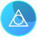 | `avatar-1` | avatar | 64 × 64 | cyan, blue, text, bg |
|  | `avatar-2` | avatar | 64 × 64 | violet, pink, text, bg |
|  | `avatar-3` | avatar | 64 × 64 | pink, orange, text, bg |
|  | `avatar-4` | avatar | 64 × 64 | lime, green, text, bg |
|  | `avatar-5` | avatar | 64 × 64 | blue, violet, text, bg |
| 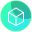 | `avatar-6` | avatar | 64 × 64 | green, cyan, text, bg |
|  | `avatar-7` | avatar | 64 × 64 | cyan, blue, text, bg |
|  | `avatar-8` | avatar | 64 × 64 | violet, pink, text, bg |
|  | `brand-logo-full` | brand | 340 × 64 | cyan, violet, pink, orange, lime, bg, text |
|  | `brand-logo-mark` | brand | 64 × 64 | cyan, violet, pink, orange, lime, bg, text |
|  | `brand-logo-mono` | brand | 340 × 64 | currentColor |
| 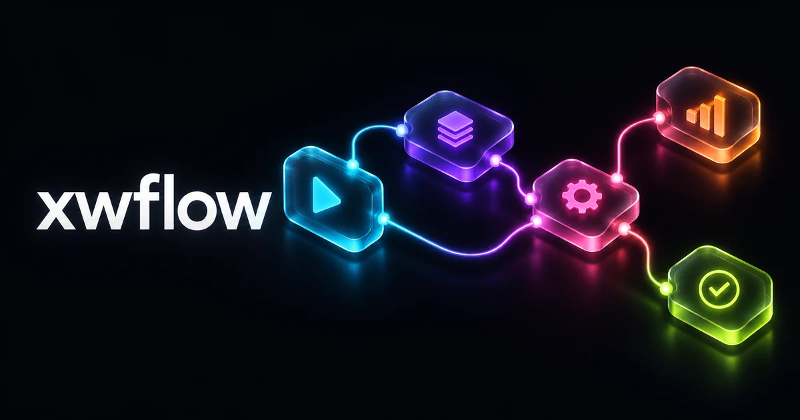 | `brand-og-image` | brand | 1200 × 630 | cyan, violet, pink, orange, lime, bg, bg2, bg3, text |
| 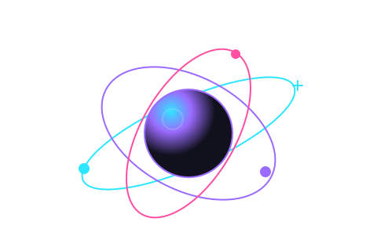 | `illustration-assistant-core` | illustration | 480 × 320 | cyan, violet, pink, text, bg3 |
| 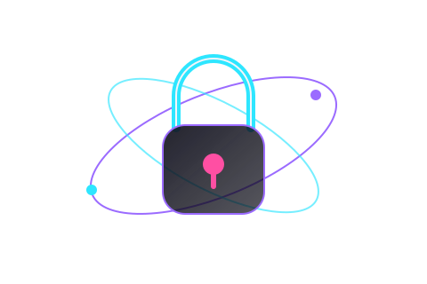 | `illustration-denied-lock` | illustration | 480 × 320 | cyan, violet, pink, text, bg2, bg3 |
| 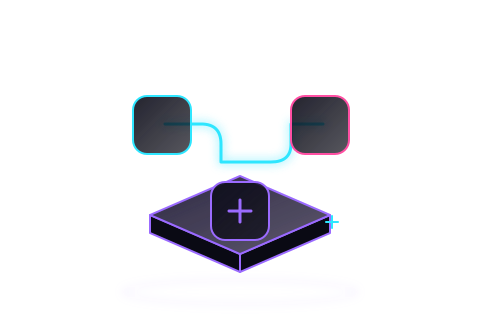 | `illustration-empty-flows` | illustration | 480 × 320 | cyan, violet, pink, bg2, bg3 |
| 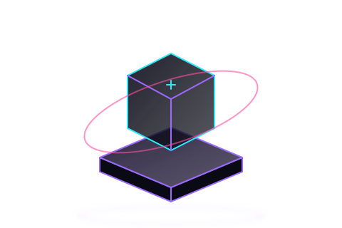 | `illustration-empty-generic` | illustration | 480 × 320 | cyan, violet, pink, bg2, bg3 |
| 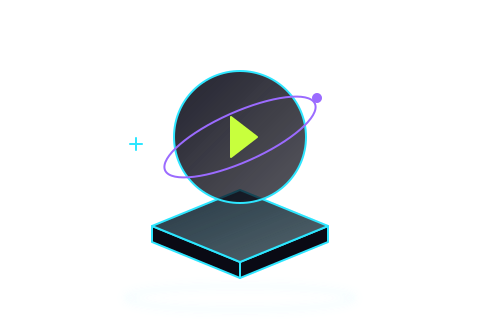 | `illustration-empty-runs` | illustration | 480 × 320 | cyan, violet, lime, bg2, bg3 |
| 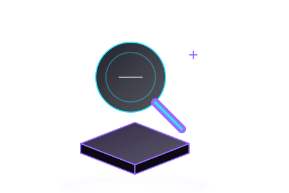 | `illustration-empty-search` | illustration | 480 × 320 | cyan, violet, muted, bg2, bg3 |
| 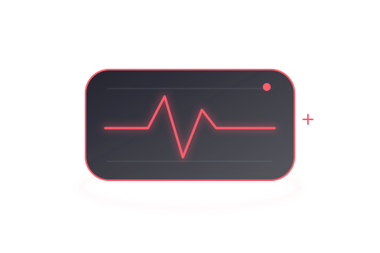 | `illustration-health-alert` | illustration | 480 × 320 | red, muted, bg2, bg3 |
| 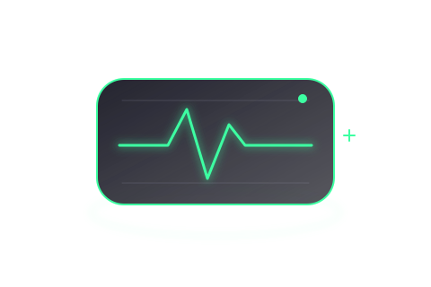 | `illustration-health-ok` | illustration | 480 × 320 | green, muted, bg2, bg3 |
| 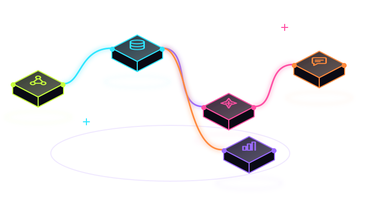 | `illustration-hero-flow` | illustration | 720 × 400 | lime, cyan, violet, pink, orange, bg2, bg3 |
| 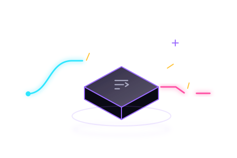 | `illustration-not-found` | illustration | 480 × 320 | cyan, violet, pink, amber, muted, bg2, bg3 |
| 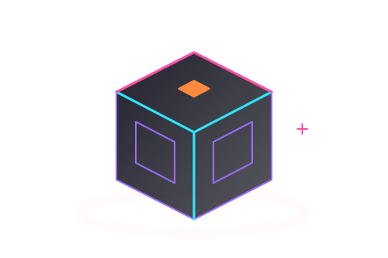 | `illustration-pricing-cube` | illustration | 480 × 320 | cyan, violet, pink, orange, bg3 |
| 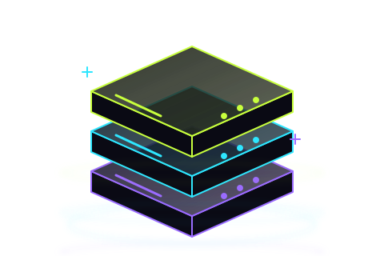 | `illustration-self-host-servers` | illustration | 480 × 320 | cyan, violet, lime, bg2, bg3 |
|  | `integration-accounting` | integration | 48 × 48 | green, cyan, text, bg3 |
|  | `integration-ai-model` | integration | 48 × 48 | lime, green, text, bg3 |
|  | `integration-analytics` | integration | 48 × 48 | violet, pink, text, bg3 |
|  | `integration-auth` | integration | 48 × 48 | lime, green, text, bg3 |
|  | `integration-calendar` | integration | 48 × 48 | violet, pink, text, bg3 |
|  | `integration-chat` | integration | 48 × 48 | cyan, blue, text, bg3 |
|  | `integration-crm` | integration | 48 × 48 | pink, orange, text, bg3 |
|  | `integration-database` | integration | 48 × 48 | blue, violet, text, bg3 |
|  | `integration-email` | integration | 48 × 48 | violet, pink, text, bg3 |
|  | `integration-files` | integration | 48 × 48 | cyan, blue, text, bg3 |
|  | `integration-forms` | integration | 48 × 48 | pink, orange, text, bg3 |
|  | `integration-git` | integration | 48 × 48 | cyan, blue, text, bg3 |
|  | `integration-hr` | integration | 48 × 48 | blue, violet, text, bg3 |
|  | `integration-http` | integration | 48 × 48 | blue, violet, text, bg3 |
|  | `integration-maps` | integration | 48 × 48 | violet, pink, text, bg3 |
|  | `integration-marketing` | integration | 48 × 48 | lime, green, text, bg3 |
| 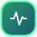 | `integration-monitoring` | integration | 48 × 48 | green, cyan, text, bg3 |
|  | `integration-payments` | integration | 48 × 48 | cyan, blue, text, bg3 |
|  | `integration-queue` | integration | 48 × 48 | blue, violet, text, bg3 |
|  | `integration-sheets` | integration | 48 × 48 | lime, green, text, bg3 |
|  | `integration-sms` | integration | 48 × 48 | pink, orange, text, bg3 |
|  | `integration-storage` | integration | 48 × 48 | green, cyan, text, bg3 |
|  | `integration-support` | integration | 48 × 48 | pink, orange, text, bg3 |
|  | `integration-webhook` | integration | 48 × 48 | green, cyan, text, bg3 |
| 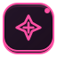 | `node-ai-condition` | node | 64 × 64 | pink, bg2, bg3 |
| 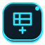 | `node-append-row` | node | 64 × 64 | cyan, bg2, bg3 |
|  | `node-code` | node | 64 × 64 | violet, bg2, bg3 |
| 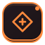 | `node-condition` | node | 64 × 64 | orange, bg2, bg3 |
|  | `node-http-request` | node | 64 × 64 | cyan, bg2, bg3 |
|  | `node-merge` | node | 64 × 64 | orange, bg2, bg3 |
|  | `node-post-message` | node | 64 × 64 | cyan, bg2, bg3 |
|  | `node-schedule` | node | 64 × 64 | lime, bg2, bg3 |
|  | `node-send-email` | node | 64 × 64 | cyan, bg2, bg3 |
| 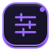 | `node-set-fields` | node | 64 × 64 | violet, bg2, bg3 |
|  | `node-wait` | node | 64 × 64 | orange, bg2, bg3 |
|  | `node-webhook` | node | 64 × 64 | lime, bg2, bg3 |
| 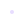 | `pattern-dot-grid` | pattern | 24 × 24 | violet |
|  | `pattern-line-grid` | pattern | 48 × 48 | cyan |
| 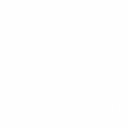 | `pattern-noise` | pattern | 128 × 128 | text |
| 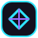 | `sample-favicon-1` | sample | 48 × 48 | cyan, violet, bg3 |
| 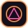 | `sample-favicon-2` | sample | 48 × 48 | orange, pink, bg3 |
|  | `sample-favicon-3` | sample | 48 × 48 | lime, green, bg3 |
|  | `sample-logo-1` | sample | 176 × 40 | cyan, violet, text |
|  | `sample-logo-2` | sample | 176 × 40 | orange, pink, text |
|  | `sample-logo-3` | sample | 176 × 40 | lime, green, text |
